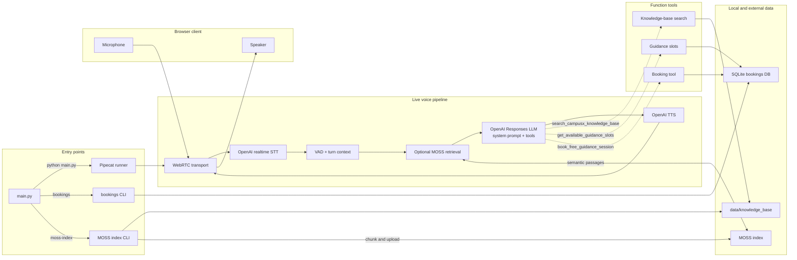

# CampusX Voice Agent

A local voice agent for CampusX guidance and booking, built with [Pipecat](https://pipecat.ai). This agent helps callers explore CampusX courses, mentorship programs, and book free 20-minute guidance sessions through natural voice conversation.

## Features

- **Voice-based interaction** - Natural speech-to-speech conversation using OpenAI Realtime STT, LLM, and TTS
- **CampusX Knowledge Base** - Answers questions about courses (DSMP, DAMP), CampusX One, pricing, curriculum, prerequisites, YouTube content, communities, and career support
- **Free Guidance Booking** - Callers can check available slots and book 20-minute guidance sessions
- **Semantic Retrieval (MOSS)** - Optional integration with pipecat-moss for semantic knowledge retrieval
- **Prompt and Tool Guardrails** - CampusX-specific policy, booking rules, and verification behavior live in the system prompt and function tools
- **WebRTC Transport** - Runs in browser via Pipecat's development runner

## Architecture

The app has one executable entry point (`main.py`) and a focused runtime package under
`src/campusx_voice_agent`. The full flow is:



### Core Components

| Module | Purpose |
|--------|---------|
| `main.py` | Single executable entry point for the bot, bookings viewer, and MOSS index builder |
| `agent.py` | Runtime composition: OpenAI STT, OpenAI Responses LLM, OpenAI TTS, context aggregators, optional MOSS, and processor ordering |
| `pipeline.py` | Shared Pipecat utilities for WebRTC transport creation, VAD/transcription turn strategies, pipeline worker lifecycle, and metrics printing |
| `tools.py` | Function tools, CampusX system prompt and policy, booking-slot generation, SQLite booking persistence, and saved-booking lookup |
| `knowledge_base.py` | Local verified markdown/text search used by the `search_campusx_knowledge_base` tool |
| `moss.py` | Optional runtime semantic retrieval processor that injects MOSS passages into `LLMContext` |
| `moss_index.py` | Offline index builder that chunks local knowledge-base markdown and uploads it to MOSS |
| `config.py` | Project paths, `.env` loading, and Windows console encoding |
| `bookings.py` | CLI renderer for saved SQLite guidance bookings |

## Prerequisites

- Python 3.12+
- OpenAI API key with access to:
  - `gpt-4o-transcribe` (STT)
  - `gpt-5` (LLM)
  - `tts-1` (TTS)
- Modern browser with WebRTC support (Chrome, Firefox, Edge)

## Installation

```bash
# Clone the repository
cd ai_voice_agent_using_pipecat

# Create virtual environment
python -m venv .venv
source .venv/bin/activate  # Windows: .venv\Scripts\activate

# Install dependencies
pip install -e ".[dev]"

# Or with uv (faster)
uv sync --dev
```

## Configuration

Environment values are loaded from `.env`. Use `.env.template` as the blank reference for the expected variables.

Required:

```env
OPENAI_API_KEY=sk-your-key-here
```

Optional:

```env
OPENAI_LLM_MODEL=gpt-5
OPENAI_STT_MODEL=gpt-4o-transcribe
OPENAI_TTS_MODEL=tts-1
OPENAI_TTS_VOICE=nova

# Custom database path for bookings
# GUIDANCE_DB_PATH=/path/to/bookings.db

# MOSS retrieval/indexing
# MOSS_PROJECT_ID=...
# MOSS_PROJECT_KEY=...
# MOSS_INDEX_NAME=...
# MOSS_TOP_K=5
# MOSS_ALPHA=0.8
# MOSS_MODEL_ID=moss-minilm
```

## Running the Agent

### Development (with browser UI)

```bash
# Start the Pipecat runner (serves a WebRTC client at http://localhost:7860)
python main.py
```

Open `http://localhost:7860` in your browser, allow microphone access, and start talking.

### CLI Commands

```bash
# View all booked guidance sessions
python main.py bookings

# Create MOSS semantic index (if using pipecat-moss)
python main.py moss-index
# or
python main.py create-moss-index
```

## Project Structure

```text
ai_voice_agent_using_pipecat/
|-- main.py                      # Single entry point (bot / bookings / moss-index)
|-- pyproject.toml               # Project metadata and dependencies
|-- .env                         # Active local environment values
|-- .env.template                # Blank reference for environment variables
|-- data/                        # Runtime data and knowledge files
|   |-- guidance_bookings.db
|   `-- knowledge_base/
|-- src/
|   `-- campusx_voice_agent/
|       |-- agent.py             # Bot wiring: STT -> optional Moss -> LLM -> TTS
|       |-- pipeline.py          # Shared Pipecat utilities
|       |-- tools.py             # Function tools (search, slots, booking)
|       |-- knowledge_base.py    # Local knowledge base search
|       |-- moss.py              # MOSS retrieval processor
|       |-- moss_index.py        # MOSS index creation CLI
|       |-- config.py            # Environment and path configuration
|       `-- bookings.py          # CLI: show_bookings()
`-- stages/                      # Step-by-step example versions
```

## Stage Flow

The `stages/` directory builds the voice agent step by step in this sequence:

| Stage | Focus |
|-------|-------|
| `00_empty_project.py` | Prove the project and virtual environment are ready |
| `01_transport_and_frames.py` | Receive browser audio in Python as Pipecat frames |
| `02_cloud_stt.py` | Add cloud STT and print transcripts |
| `03_turn_detection_and_context.py` | Add Silero VAD, explicit turn boundaries, and user context |
| `04_llm_without_identity.py` | Add a generic text LLM with no business identity yet |
| `05_system_prompt.py` | Give the LLM a CampusX booking role and voice-safe behavior |
| `06_moss_create_index.py` | Create a Moss index from the local CampusX knowledge base |
| `07_moss_rag_before_llm.py` | Retrieve Moss passages before the LLM answers |
| `08_tts_audio_frames.py` | Synthesize OpenAI audio frames without sending them to the browser yet |
| `09_conversation_memory.py` | Send TTS to the browser and save assistant turns in context |
| `10_final_voice_agent.py` | Combine booking tools, browser TTS, conversational context, Moss retrieval, and barge-in handling |

Moss enriches context before generation. Function tools come later for actions such as checking and booking guidance slots.

## How It Works

1. **Caller speaks** - WebRTC audio captured in browser
2. **STT** (OpenAI Realtime) transcribes speech to text
3. **Turn detection** (VAD + transcription) determines when user finishes
4. **Optional Moss retrieval** adds relevant semantic passages to the LLM context when Moss is configured
5. **LLM** (GPT-5) generates a response with:
   - System prompt defining CampusX specialist personality and policy
   - Function tools for knowledge search and booking
   - Optional Moss semantic context injected before the LLM
6. **TTS** (OpenAI) streams audio back to browser
7. **Assistant context is kept in the live pipeline, and metrics are printed after output frames pass through the transport**
8. **Booking** (if requested) stores confirmed sessions in SQLite

## Prompt and Tool Policy

The agent enforces these rules through `GUIDANCE_SYSTEM_PROMPT` and the function tools in `tools.py`:
- Only answer CampusX-related questions from the caller's context
- Never invent CampusX information
- Never promise jobs, salaries, future launches, discounts, refunds, or private links
- Use verified info only; direct to `support@campusx.in` for account/payment issues
- Keep replies short, warm, and natural for speech

## Extending the Agent

### Add Knowledge Base Content
Add `.md` or `.txt` files to `data/knowledge_base/` - they are searched by the local knowledge-base tool and can be uploaded to MOSS with `python main.py moss-index`.

### Add New Tools
1. Define async function in `tools.py` with `FunctionCallParams`
2. Add to `GUIDANCE_TOOLS` list
3. Update `GUIDANCE_SYSTEM_PROMPT` with tool description

### Modify Prompt Policy
Edit the guardrail instructions inside `GUIDANCE_SYSTEM_PROMPT` in `tools.py`.

## Troubleshooting

| Issue | Solution |
|-------|----------|
| "Missing environment variable: OPENAI_API_KEY" | Add the key to `.env` |
| No audio in browser | Allow microphone permission; check HTTPS (required for WebRTC) |
| Moss retrieval disabled | Set `MOSS_PROJECT_ID`, `MOSS_PROJECT_KEY`, and `MOSS_INDEX_NAME`, or leave them unset to use only the local knowledge-base tool |
| Booking slots not showing | Ensure `data/` is writable; check SQLite permissions |
